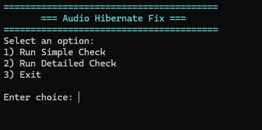
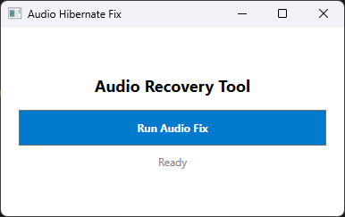
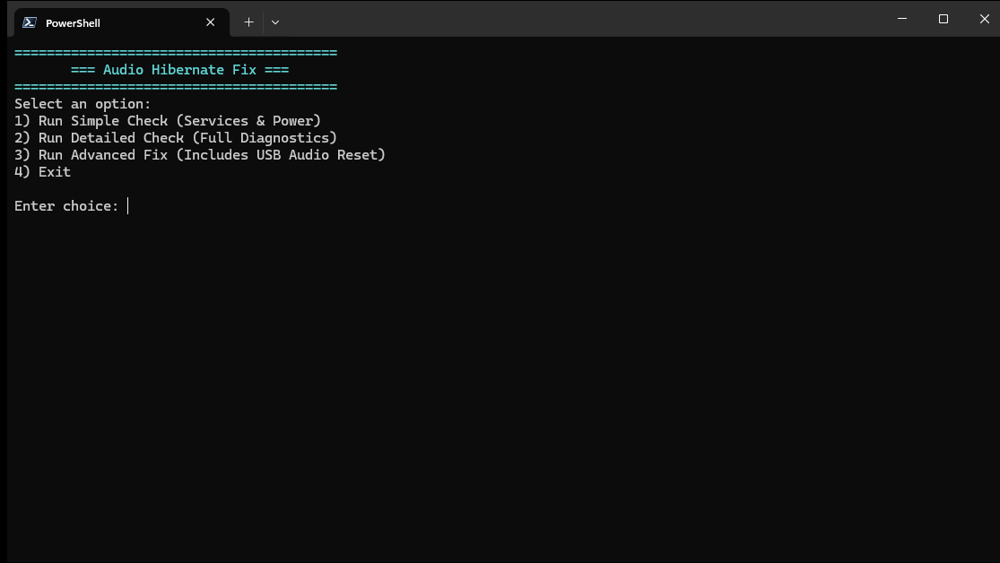

# Audio Hibernate Fix

A lightweight, native C# WPF desktop utility designed to automatically fix audio device freezing and looping issues (specifically tailored for external USB sound cards like the **Sound Blaster GC7**) after Windows hibernation.  
Designed for simplicity, clarity, and readability.

## Overview
Some Windows builds historically exposed a fast‑resume initialization policy that can cause the audio subsystem to fail after waking from hibernate.  
Symptoms include:
- No sound output despite devices appearing present
- Audio services running but not properly bound
- Audio endpoint failing to re‑initialize

AudioHibernateFix performs sequential recovery by gracefully stopping and restarting critical Windows audio services (`audiosrv` and `AudioEndpointBuilder`) with safe execution delays.

## Features
- Clean, native WPF desktop interface
- Sequential service recovery with built-in timing safety to prevent driver loops
- Automatic UAC elevation via application manifest
- Safe, non‑destructive execution

## Requirements
- Windows 10 / 11
- .NET 10.0 Runtime

## Usage
1. Launch **AudioHibernateFix.exe** (Administrator privileges required).
2. Click **Run Audio Fix**.
3. The status indicator will walk through the recovery sequence and confirm once your audio has been successfully restored.

## Versioning
**v2.x — Native WPF Release**
- Migrated from PowerShell scripts to a standalone C# WPF desktop application
- Native service management and execution control
- Polished graphical interface

### Visual Representation of UI

> Screenshot of the native WPF audio recovery interface.

## Interfaces & Evolution

### Native C# WPF Application (v3.0+)
A single-click utility that automates the complete audio recovery pipeline.

### Legacy Diagnostic Script (v1.0 - v2.10)
The original menu-driven PowerShell script used for manual diagnostics and toggles.

## License
MIT License  
Copyright © 2026 ConceptExplorer